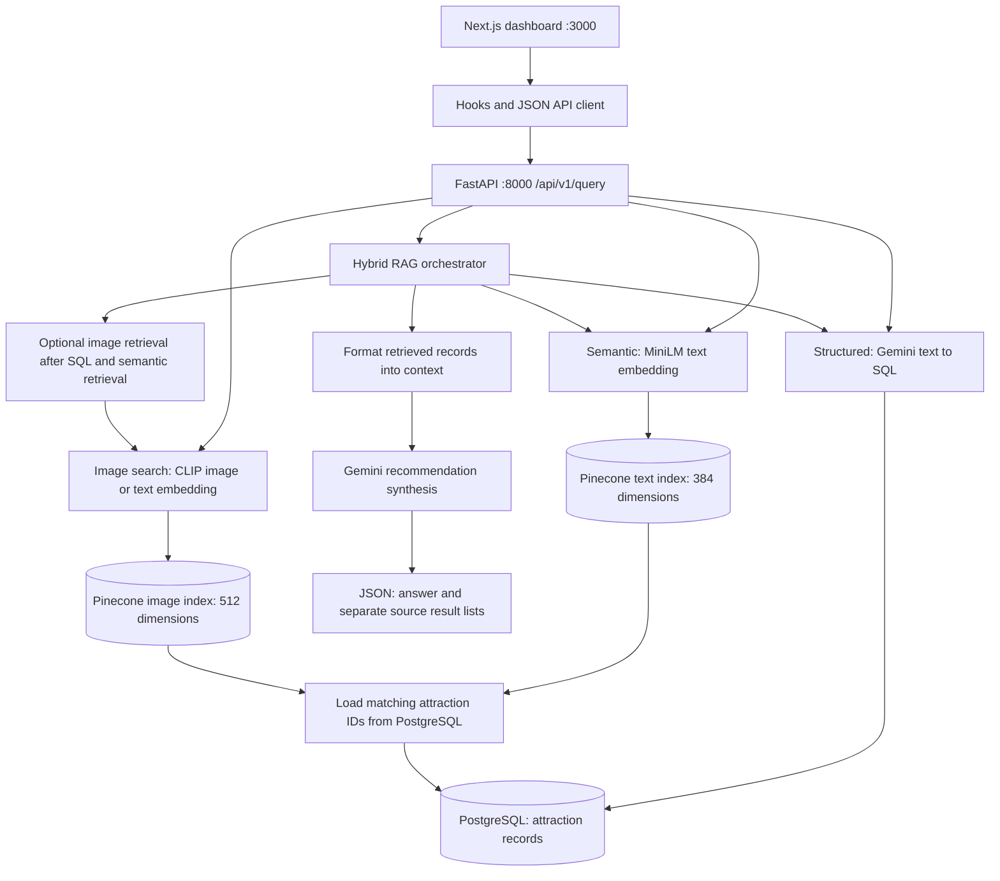
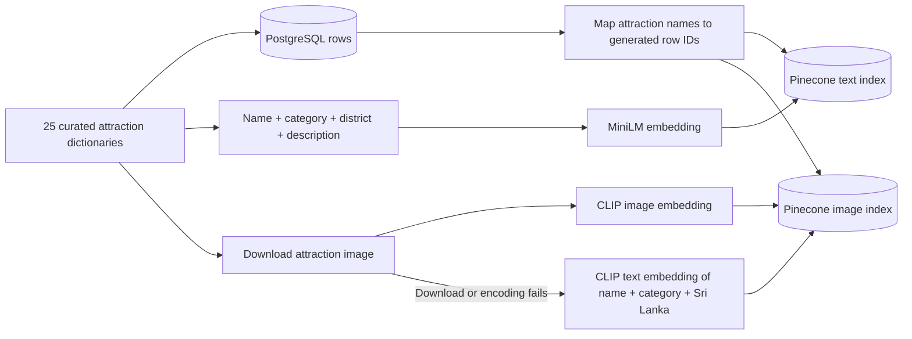

# LankaRAG

LankaRAG is a Sri Lanka tourism search application with a Next.js dashboard and a FastAPI backend. It combines structured facts in PostgreSQL, semantic text retrieval in Pinecone, visual similarity using CLIP, and Google Gemini recommendations.

The repository includes **25 curated attractions**, with five each in Beaches, Waterfalls, Historical Sites, National Parks, and Temples. These are local sample records, not a live tourism feed.

## Contents

- [Architecture](#architecture)
- [Data ingestion and indexing](#data-ingestion-and-indexing)
- [How the four query pipelines work](#how-the-four-query-pipelines-work)
- [Frontend request and display flow](#frontend-request-and-display-flow)
- [Local setup](#local-setup)
- [Configuration](#configuration)
- [API reference and examples](#api-reference-and-examples)
- [Repository layout](#repository-layout)
- [Checks and tests](#checks-and-tests)
- [Updating the dataset](#updating-the-dataset)
- [Troubleshooting and current limitations](#troubleshooting-and-current-limitations)

## Architecture



| Component | Role |
| --- | --- |
| Next.js 16.2.12, React 19, TypeScript | Dashboard using the App Router |
| Tailwind CSS v4, lucide-react | Styling and icons |
| FastAPI, Pydantic | HTTP routes, request validation, response schemas |
| SQLAlchemy 2, asyncpg | Async PostgreSQL access during queries |
| PostgreSQL 15 | Full attraction records and exact fact filtering |
| Pinecone Serverless | Cosine similarity search in separate text and image indexes |
| SentenceTransformer `all-MiniLM-L6-v2` | Normalized 384-dimensional text embeddings |
| OpenAI CLIP `ViT-B/32`, PyTorch | Normalized 512-dimensional image and text embeddings |
| Gemini through LangChain | Natural language to SQL and final hybrid answer generation |
| pytest, pytest-asyncio, httpx | Existing backend service and HTTP tests |

The two Pinecone indexes are necessary because MiniLM and CLIP produce different dimensions and embedding spaces. CLIP's text encoder shares a space with CLIP's image encoder; MiniLM vectors cannot be searched against the image index.

## Data ingestion and indexing

Source data lives in [`backend/scripts/attractions.py`](backend/scripts/attractions.py). Run [`backend/scripts/ingest.py`](backend/scripts/ingest.py) before querying a new installation.



1. Create `tourist_attractions` if it does not exist, insert the seed records, and collect their database IDs.
2. Create the configured Pinecone text index if missing, with dimension `384`, cosine metric, and AWS region from `PINECONE_ENVIRONMENT`.
3. Encode each attraction's name, category, district, and full description as one text vector. There is **no document splitting or chunk overlap**: one attraction is the retrieval unit.
4. Upsert vectors in batches of 100, using the PostgreSQL ID as the vector's string ID. Text metadata includes name, category, district, fee, and difficulty.
5. Create the image index if missing, with dimension `512` and cosine metric. Download images, convert them to RGB, preprocess them, and encode them with CLIP.
6. If image downloading or encoding fails, use a CLIP text embedding of the attraction's name, category, and `Sri Lanka`. Entries without an image URL are skipped. Image metadata includes name, category, district, and image URL.

PostgreSQL stores `id`, `name`, `category`, `district`, `entrance_fee_usd`, `difficulty_level`, `description`, and `image_url`. Fees may be null; the synthesis formatter treats null as free entry. The seed data also uses `0.0` for free attractions.

Pinecone supplies matching IDs and similarity scores. Both vector search services fetch the full matching records from PostgreSQL, preserve Pinecone's ranking, round scores to four decimal places, and skip IDs absent from PostgreSQL. Vector search therefore also requires the relational database.

**Ingestion is not currently safe to rerun without duplicates.** Although inserts use `ON CONFLICT DO NOTHING`, the table has no unique constraint on attraction name. Reruns can create new rows and new vector IDs while leaving old vectors in place. See [Updating the dataset](#updating-the-dataset).

## How the four query pipelines work

Only the hybrid endpoint generates a final travel recommendation. The other three return retrieved attraction records, with SQL or embedding information as appropriate. Retrieval uses existing records; there is no fine-tuning, live web search, or conversation memory.

### 1. Structured: natural language → SQL → PostgreSQL

Entry point: [`structured.py`](backend/app/api/v1/endpoints/structured.py), using [`sql_service.py`](backend/app/services/sql_service.py).

1. Send the question, table schema, allowed categories, and row limit to Gemini with temperature `0.0`.
2. The prompt asks for a `SELECT *` query against `tourist_attractions`, with a `LIMIT` and no explanation.
3. Strip accidental Markdown code fences and a trailing semicolon.
4. Check that SQL starts with `SELECT` and contains none of the configured forbidden write/DDL keywords. Rejected SQL returns HTTP `400`.
5. Execute the generated SQL. Partial-column queries are wrapped in a full-row lookup by name; this requires the subquery to expose `name`.
6. Return attraction rows with `source: "postgres"`, the generated SQL, and the returned row count. The result list is sliced to `top_k`.

Use this for questions such as “Which waterfalls have an entrance fee under $5?” Exact fee, district, and difficulty conditions depend on the SQL Gemini generates.

### 2. Semantic: query meaning → text vectors → attraction records

Entry point: [`semantic.py`](backend/app/api/v1/endpoints/semantic.py), using the embedding and vector services.

1. Encode the question with MiniLM into a normalized 384-dimensional vector.
2. Query the Pinecone text index for `top_k` nearest matches.
3. If `category_filter` is supplied, apply an exact Pinecone metadata equality filter.
4. Load matching PostgreSQL records and return ranked results with `source: "pinecone-text"`, similarity scores, and the embedding model name.

Use this for descriptive requests such as “quiet places surrounded by greenery.” Similarity search does not enforce numeric constraints such as a maximum fee. No Gemini call is needed for this endpoint.

### 3. Image search: image or visual description → CLIP → attraction records

Entry point: [`image_search.py`](backend/app/api/v1/endpoints/image_search.py).

1. Accept either `image_url` (a direct image URL or base64 image data URI) or `text_prompt`. Neither provided returns HTTP `400`.
2. If both are supplied, the image takes priority. A failed image does not trigger a retry with `text_prompt`.
3. For an image, fetch bytes with `httpx.AsyncClient` using a 15-second timeout, or decode the data URI. Convert to RGB and run the CLIP image encoder.
4. For a text description, tokenize it and run CLIP's text encoder.
5. Search the 512-dimensional Pinecone image index and hydrate records from PostgreSQL.
6. Return results with `source: "pinecone-image"`, scores, `embedding_model`, and `query_type` (`image` or `text-clip`).

This finds visually related catalog entries; it is not guaranteed landmark identification. Some indexed vectors may represent the ingestion text fallback instead of an actual photograph. Query images are encoded for retrieval and are not added to the catalog.

### 4. Hybrid: multi-source retrieval → context → Gemini answer

Entry point: [`hybrid.py`](backend/app/api/v1/endpoints/hybrid.py), orchestrated by [`rag_service.py`](backend/app/services/rag_service.py).

1. Start SQL retrieval and semantic retrieval together with `asyncio.gather`. Each branch opens its own database session so a SQL failure does not invalidate the semantic branch's transaction.
2. SQL retrieval generates and validates SQL, then loads up to `top_k` records. Its SQL generation currently uses the service's default prompt limit of 20; the returned rows are still sliced to the requested `top_k`.
3. Semantic retrieval embeds the same query and searches the text index. Hybrid requests do not expose a category metadata filter.
4. After these two branches complete, perform image retrieval **only if `image_url` is present**. This uses a separate database session. Text-only hybrid queries do not automatically run a CLIP text search.
5. Each retrieval branch catches failures, rolls back its session, logs the error, and supplies an empty result list. Other successful branches can still contribute context.
6. Format three labeled context sections: structured, semantic, and image. Each record contributes name, category, district, fee, difficulty, optional similarity score, and the first 200 description characters. Empty sections explicitly state that no results were found.
7. Compose the LangChain prompt and Gemini client, then call `ainvoke`. The prompt asks “LankaGuide” to combine the sources, highlight facts, group by category where useful, add travel tips, and keep the Markdown answer under 500 words. Synthesis uses temperature `0.4` and `max_output_tokens=1024`.
8. Return `ai_response`, the three separate result lists, and `total_sources`, which is the **sum of their lengths**, including repeated attractions across branches.

For “family-friendly national parks under $20,” SQL may filter by fee while semantic retrieval contributes descriptive matches. Their results are passed together to Gemini. There is no shared hard filter, cross-source reranker, weighted score fusion, or deduplication, so a semantic match can fall outside the SQL budget condition.

This is retrieval-augmented generation: retrieved catalog facts are added to the generation prompt. The generator receives formatted text, not the uploaded image itself. Prompt instructions do not guarantee factuality, and synthesis is still attempted if all retrieval lists are empty. A synthesis failure returns HTTP `500`.

Models and Gemini clients are loaded lazily and cached per process. CLIP uses CUDA when available, otherwise CPU. Image downloading is asynchronous; model inference and Pinecone SDK calls are synchronous inside the async service flow.

## Frontend request and display flow

1. [`frontend/app/page.tsx`](frontend/app/page.tsx) holds query type, query text, image input, category filter, and `top_k` (default `5`). The UI slider offers 1–10 results.
2. `SearchPanel` presents the four modes. The category selector is available for semantic search. Image and hybrid modes support image input.
3. `ImageUploader` accepts a direct URL or reads a local JPEG, PNG, or WebP file as a base64 data URI. The UI checks file type and a 5 MB size limit; requests remain JSON, not multipart uploads.
4. Submitting clears previous hook results and calls the selected `useStructuredQuery`, `useSemanticQuery`, `useImageQuery`, or `useHybridQuery` hook.
5. The hook manages loading, data, errors, and reset state. Its `lib/api/` service calls the shared `post` client, which uses `NEXT_PUBLIC_API_URL` and raises `ApiError` for failed HTTP responses.
6. `ResultsPanel` displays loading placeholders, errors, attraction cards, generated SQL for structured queries, and the AI answer plus source-specific result sections for hybrid queries. Hybrid results are also concatenated without deduplication.

### Why there is only one frontend app folder

`frontend/app/` is the active App Router directory and contains the LankaRAG dashboard, layout, metadata, fonts, and theme. The former `frontend/src/app/` contained the unused Create Next App starter screen, layout, CSS, and favicon. It has been removed. The root `app/` directory takes precedence when present; the project needs only this one routing tree. The `@/*` TypeScript alias points to the frontend root, where shared components, hooks, and API modules live.

## Local setup

### Prerequisites

- Docker with Compose for PostgreSQL.
- Python **3.11 recommended** for the pinned backend dependencies.
- Node.js **22.13+** and npm for the frontend dependency set.
- Pinecone API credentials and a Gemini API key with access to the configured model.
- Internet access for packages, model weights on first use, Pinecone, Gemini, and seed image downloads.

### 1. Configure the repository

From the repository root:

```bash
cp .env.example .env
```

Edit `.env`, especially `PINECONE_API_KEY`, `GEMINI_API_KEY`, and `GEMINI_MODEL`. The template sets `GEMINI_MODEL=gemini-flash-latest`; the Python fallback is `gemini-1.5-flash`. Set the model explicitly to one available to your account. Neither model's availability is checked by the health endpoint.

Configure the frontend separately in `frontend/.env.local`:

```dotenv
NEXT_PUBLIC_API_URL=http://localhost:8000
```

Next.js runs from `frontend/`; the root `.env` entry alone does not configure its public API URL. The client falls back to `http://localhost:8000` if the variable is absent.

### 2. Start PostgreSQL

```bash
docker compose up -d
docker compose ps
```

Compose runs PostgreSQL 15 on host port `5432` and persists data in a named Docker volume. It does not start the backend or frontend. It also does not seed the table.

### 3. Install the backend

```bash
cd backend
python3.11 -m venv .venv
source .venv/bin/activate
# Windows: .venv\Scripts\activate
python -m pip install -r requirements.txt
python -m pip install git+https://github.com/openai/CLIP.git
```

CLIP is installed separately; `torch` and `sentence-transformers` are in `requirements.txt`.

### 4. Populate the database and indexes once

From `backend/`, with the environment activated:

```bash
python scripts/ingest.py
```

The script requires Pinecone credentials, PostgreSQL, model downloads, and access to seed images. It does not call Gemini. Watch logs for image failures and CLIP text fallbacks. Existing indexes must have the expected dimensions; index creation does not migrate an incompatible index. App startup checks connectivity but does not run ingestion or create indexes.

### 5. Start FastAPI

From `backend/`:

```bash
uvicorn app.main:app --reload --host 0.0.0.0 --port 8000
```

- Dashboard backend: `http://localhost:8000/`
- Swagger: `http://localhost:8000/docs`
- ReDoc: `http://localhost:8000/redoc`
- Health: `http://localhost:8000/health`

### 6. Start Next.js in another terminal

From the repository root:

```bash
cd frontend
npm ci
npm run dev
```

Open `http://localhost:3000`. For a production frontend build, run `npm run build` followed by `npm start` from `frontend/`, with the backend running separately. Public frontend environment variables must be set when building. The layout uses `next/font/google` for Inter and Outfit, so builds need access to Google Fonts.

## Configuration

Backend settings are defined in [`config.py`](backend/app/core/config.py). Environment files are resolved relative to the working directory in this order: `../../.env`, `../.env`, `.env`; later files override earlier ones, and process environment variables take precedence. Use the documented `backend/` working directory. Settings are cached, so restart the backend after changing them.

| Variable | Default / behavior |
| --- | --- |
| `POSTGRES_USER` | `lankarag` |
| `POSTGRES_PASSWORD` | `lankarag_secret`; replace for a shared environment |
| `POSTGRES_DB` | `lankarag_db` |
| `POSTGRES_HOST` | `localhost` |
| `POSTGRES_PORT` | `5432`; Compose's published host port is fixed at `5432` |
| `PINECONE_API_KEY` | Empty; required for ingestion and vector retrieval |
| `PINECONE_ENVIRONMENT` | `us-east-1`; AWS Serverless region when creating indexes |
| `PINECONE_TEXT_INDEX` | `lankarag-text`; 384 dimensions, cosine |
| `PINECONE_IMAGE_INDEX` | `lankarag-images`; 512 dimensions, cosine |
| `GEMINI_API_KEY` | Empty; required for SQL generation and hybrid synthesis |
| `GEMINI_MODEL` | Python fallback `gemini-1.5-flash`; template uses `gemini-flash-latest` |
| `CORS_ORIGINS` | `http://localhost:3000`; comma-separated browser origins |
| `BACKEND_HOST`, `BACKEND_PORT` | Settings defaults `0.0.0.0`, `8000`; pass host/port to Uvicorn explicitly |
| `LOG_LEVEL` | Settings default `INFO`; current application logging is hardcoded to `INFO` |
| `NEXT_PUBLIC_API_URL` | Frontend API base URL; set in `frontend/.env.local`; client fallback `http://localhost:8000` |

Async and sync PostgreSQL URLs are constructed from the `POSTGRES_*` settings. The commented `DATABASE_URL` example in `.env.example` is not a supported override in the current `Settings` class.

## API reference and examples

All four query endpoints accept JSON via `POST` under `/api/v1/query`.

| Endpoint suffix | Inputs | `top_k` default / range | Response fields |
| --- | --- | --- | --- |
| `/structured` | Required `query` | `10` / 1–50 | `results`, `generated_sql`, `total` |
| `/semantic` | Required `query`; optional `category_filter` | `5` / 1–20 | `results`, `query_embedding_model` |
| `/image-search` | `image_url` or `text_prompt` | `5` / 1–20 | `results`, `query_type`, `embedding_model` |
| `/hybrid` | Required `query`; optional `image_url` | `5` / 1–20 per branch | `ai_response`, `structured_results`, `semantic_results`, `image_results`, `total_sources` |

Each attraction result contains the database fields plus nullable `score` and a `source` label: `postgres`, `pinecone-text`, or `pinecone-image`. Similarity scores are cosine similarities, not confidence probabilities. `total` is the number of returned structured rows, not a count of all matching database records. Hybrid `total_sources` counts returned records across branches, not distinct attractions or source systems.

```bash
# Exact facts
curl -X POST http://localhost:8000/api/v1/query/structured \
  -H 'Content-Type: application/json' \
  -d '{"query":"Which waterfalls have an entrance fee under $5?","top_k":5}'

# Meaning-based retrieval with an exact category filter
curl -X POST http://localhost:8000/api/v1/query/semantic \
  -H 'Content-Type: application/json' \
  -d '{"query":"calm water and a relaxed atmosphere","category_filter":"Beaches","top_k":3}'

# Search indexed images using a visual description
curl -X POST http://localhost:8000/api/v1/query/image-search \
  -H 'Content-Type: application/json' \
  -d '{"text_prompt":"lush green waterfall surrounded by jungle","top_k":3}'

# Retrieve from SQL and text vectors, then generate a recommendation
curl -X POST http://localhost:8000/api/v1/query/hybrid \
  -H 'Content-Type: application/json' \
  -d '{"query":"best national parks for a family safari under $20","top_k":3}'
```

For image-based requests, set `image_url` to a direct image URL or `data:image/...;base64,...`. Adding it to a hybrid request enables the optional third retrieval branch.

Missing required fields or invalid `top_k` values return `422`; image search without input and rejected structured SQL return `400`. Unhandled service errors return `500` with a `detail` field. Hybrid retrieval failures are handled internally and can yield a successful response with fewer sources.

`GET /health` returns `status`, `postgres`, `pinecone_text`, `pinecone_image`, and `gemini`. Its overall `status` depends only on PostgreSQL and whether a Gemini key is configured. It can say `ok` while Pinecone checks report errors, and it does not make a Gemini inference request or check model availability. Inspect the individual fields.

## Repository layout

```text
LankaRAG/
├── README.md
├── .env.example
├── docker-compose.yml             # PostgreSQL only
├── backend/
│   ├── requirements.txt
│   ├── pytest.ini
│   ├── app/
│   │   ├── main.py                # App, CORS, startup checks, health/root routes
│   │   ├── api/v1/
│   │   │   ├── router.py          # /api/v1/query route aggregation
│   │   │   └── endpoints/         # structured, semantic, image_search, hybrid
│   │   ├── core/
│   │   │   ├── config.py          # Environment settings and database URLs
│   │   │   └── db.py              # Async sessions and Pinecone clients/checks
│   │   ├── models/attraction.py   # SQLAlchemy attraction model
│   │   ├── schemas/               # Attraction and query request/response models
│   │   └── services/
│   │       ├── embedding_service.py # Lazy MiniLM/CLIP loading and encoding
│   │       ├── vector_service.py  # Pinecone search and PostgreSQL hydration
│   │       ├── sql_service.py     # Gemini SQL generation, guard, execution
│   │       └── rag_service.py     # Retrieval orchestration and synthesis prompt
│   ├── scripts/
│   │   ├── attractions.py         # Curated source dataset
│   │   └── ingest.py              # DDL, seed inserts, embedding upserts
│   └── tests/
│       ├── conftest.py            # Shared sample data and fixtures
│       ├── api/test_endpoints.py  # HTTP route tests
│       └── services/test_rag.py   # SQL, vector, and RAG service tests
└── frontend/
    ├── README.md
    ├── package.json
    ├── package-lock.json
    ├── app/                      # The single App Router tree
    │   ├── layout.tsx             # Inter/Outfit, metadata, inline palm favicon
    │   ├── page.tsx               # Dashboard state and request orchestration
    │   └── globals.css            # Theme and Tailwind styles
    ├── components/
    │   ├── atoms/                 # Button, Badge, Input, Typography
    │   ├── molecules/             # QuerySelector, SearchBar, FilterTags
    │   └── organisms/             # Search/results panels, uploader, cards
    ├── hooks/                     # One query hook per API mode
    ├── lib/api/                   # JSON client, types, endpoint services
    ├── public/                    # Static assets
    ├── utils/cn.ts                # clsx + tailwind-merge
    ├── tsconfig.json              # @/* resolves from frontend root
    ├── next.config.ts
    ├── eslint.config.mjs
    └── postcss.config.mjs
```

## Checks and tests

Frontend, from `frontend/`:

```bash
npm run lint
npx tsc --noEmit
npm run build
```

Backend, from `backend/` with the virtual environment activated:

```bash
python -m pytest tests/ -v
python -m pytest tests/services/ -v
python -m pytest tests/api/ -v
```

The existing tests use mocks for external integrations and cover SQL guards, result mapping, vector retrieval, RAG calls, HTTP schemas, and error responses. They are not end-to-end verification of real credentials, index contents, model weights, or generated answers. Some current fixtures patch `app.core.db` functions that consumers import directly, and hybrid tests do not consistently replace the service's session factory; review those fixtures if tests attempt real connections. Do not assume the suite is fully isolated. Coverage reporting additionally requires `pytest-cov`, which is not included in `requirements.txt`.

## Updating the dataset

1. Edit the dictionaries in `backend/scripts/attractions.py`, keeping the documented fields and category names consistent. Categories also appear in the SQL prompt and frontend TypeScript types and selectors.
2. For a fresh installation, run the ingestion script once. For an existing dataset, implement an update path that reuses PostgreSQL IDs and re-upserts the corresponding vectors; the supplied script does not update existing rows reliably.
3. Re-embed changed descriptions or images. Updating PostgreSQL alone changes displayed facts but leaves vector similarity and metadata filters based on stale content.
4. If removing records, remove corresponding Pinecone vectors as well. Unmatched IDs are skipped during hydration and can reduce the number of returned matches.
5. Changing embedding models or dimensions requires rebuilding the appropriate index and updating ingestion and query encoding together.

There is currently no admin CRUD API, scheduled refresh, migration system, or automatic index synchronization.

## Troubleshooting and current limitations

| Symptom | What to check |
| --- | --- |
| Backend cannot connect to PostgreSQL | Run `docker compose ps`; compare `POSTGRES_*` settings with container credentials and published port. Existing Docker volumes retain their initialized credentials. |
| Missing `tourist_attractions` or missing indexes | Run ingestion; startup does not create them. |
| Pinecone dimension mismatch | Use distinct indexes with 384 text dimensions and 512 CLIP dimensions, and matching encoding models. |
| Gemini errors | Check key, quota, and the explicit `GEMINI_MODEL`; `/health` only checks key presence. |
| Frontend cannot reach API | Check backend port and `frontend/.env.local`, then restart Next.js; rebuild production bundles after public env changes. |
| Browser CORS error | Add the actual frontend origin to `CORS_ORIGINS`, especially if Next.js chose another port. |
| Slow first query | MiniLM and CLIP load on first use and may download model weights. CPU inference can take time. |
| Image decoding/download error | Supply image bytes via a direct image link or local upload; webpage URLs are not image files. |
| Duplicate attractions after ingestion | Reruns can insert duplicates; inspect row/vector IDs before running ingestion again. |
| Unexpected hybrid recommendations | Inspect each result list and backend warnings; branches can fail independently and vector matches do not inherit SQL constraints. |

The current SQL guard is a prefix and keyword check, not a SQL parser or a database permission boundary. It does not enforce the prompt's table restriction. The ingestion script also overrides Python's default HTTPS context to disable certificate verification for model downloads. These implementation details need hardening before deployment to a shared environment.

The repository has no application authentication, rate limiting, or citation validation for generated recommendations. Attraction fees and descriptions are seed data, and answers may include model-generated advice beyond retrieved facts. Best-time-to-visit information is not a dedicated structured field; it may appear in descriptions or generated text.
